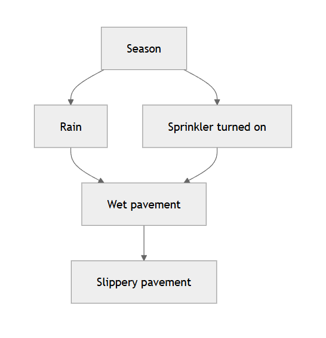
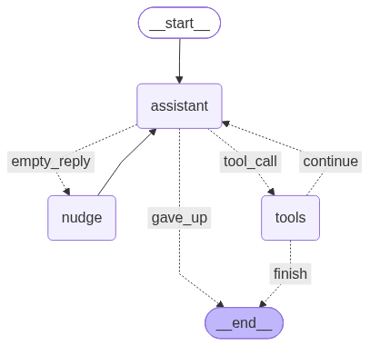

# Brief introduction to causal inference and causal DAGs

Causal inference is the branch of statistics that deals with identifying what will happen to a variable if we change another variable. This may seem trivial, but it is not. Philosophically speaking, we could argue that causal inference is the most difficult problem an animal, a human, an agent, or any other system with a goal to reach must solve. Knowing the consequences of our actions is fundamental to any goal-seeking behavior. The layman might have heard the expression "correlation is not causation." This is exactly the crux of the problem.

In statistics, the most common way to represent the causal relationships between variables is through a causal graph. This consists of a set of nodes, each representing a variable, and a set of edges, each representing a causal relationship between two variables. The edges are directed, and the whole graph has no cycles. This structure is called a Directed Acyclic Graph (DAG).

Consider a pavement on a day when it might rain. Each box is a variable. An arrow means that changing the variable at the tail can change the variable at the head.

- **Season → Rain.** A wet season brings rain. A dry season does not.
- **Season → Sprinkler turned on.** In a dry season you turn the sprinkler on. When rain is already likely, you leave it off.
- **Rain → Wet pavement** and **Sprinkler turned on → Wet pavement.** Rain and the sprinkler are two different ways to wet the ground.
- **Wet pavement → Slippery pavement.** The water on the pavement is what makes it slippery.

Suppose that today is a bright, sunny day. The sprinkler is off and the pavement is dry. This is the **factual** state of the world. But what if we had previously turned on the sprinkler? What would have happened? This is a **counterfactual** state of the world.

The **fundamental problem of causal inference** is the inability to observe both the factual and the counterfactual state of the world at the same time. This makes it impossible to do actual causal inference without making assumptions.

However, today we will explore the **other reason** causal inference is difficult, namely that the number of possible causal DAGs is enormous.

The precise growth rate for the number of possible causal DAGs with $$n$$ nodes was proven by mathematician Robert W. Robinson in 1973. It is asymptotic to:

$$
G(n) \sim C \cdot M^{n} \cdot 2^{\frac{n(n-1)}{2}}
$$

To put this super-exponential growth into perspective, here is the number of possible causal DAGs for a few values of $$n$$:

$$
\begin{array}{c|l}
n & \text{Number of DAGs } (G(n)) \\
1  & G(1) = 1 \\
2  & G(2) = 3 \\
3  & G(3) = 25 \\
5  & G(5) = 29281 \\
10 & G(10) \approx 4.175 \times 10^{18} \\
20 & G(20) \approx 2.345 \times 10^{72} \\
\end{array}
$$

## The Causal DAG agent explorer

Undeterred by the size of that space, I built an agent that searches it the same way a human would. It never sees the hidden DAG. It only proposes edges, freezes nodes to invent counterfactuals, and reads back what the graph does.

The search is a loop. A language model sits in the **assistant** node and, each turn, has to call one tool. If it does, the **tools** node runs that call and hands the result back, and the assistant goes again. If it replies with text and no tool, a **nudge** tells it to think less and call one tool. After three empty replies, the run gives up. The loop ends when the model calls finish and commits the edges it believes are there.

Five tools are enough for the whole game:

- **show_status** returns the hypothesized adjacency matrix and the current value of each node.
- **draw_edge** adds one directed edge to that hypothesis.
- **freeze_node** sets a node to a chosen value. That is how the agent builds a counterfactual.
- **unfreeze_node** lets the node be computed from its parents again.
- **finish** stops the exploration.

Each run is traced in a local [Langfuse](https://langfuse.com) project. The trace keeps the model calls, the tool calls, and the reasoning produced along the way, so a finished search can be read back one step at a time.

## Recorded runs

Each recording is one complete search. They might have been cut for brevity and ease of viewing.

You can also try the same game and discover a causal DAG from counterfactual data yourself.
You can find the game at this link:
[Causal DAG discovery game]()

  

    <button type="button" class="run-viewer-prev">Previous</button>
    <button type="button" class="run-viewer-tab" aria-pressed="true" data-index="0">2 nodes</button>
    <button type="button" class="run-viewer-tab" aria-pressed="false" data-index="1">3 nodes</button>
    <button type="button" class="run-viewer-tab" aria-pressed="false" data-index="2">4 nodes</button>
    <button type="button" class="run-viewer-next">Next</button>
  

  

## Final note
All the code can be found [here](https://github.com/piantedosi/dag_explorer)

[back home](https://piantedosi.github.io/)

