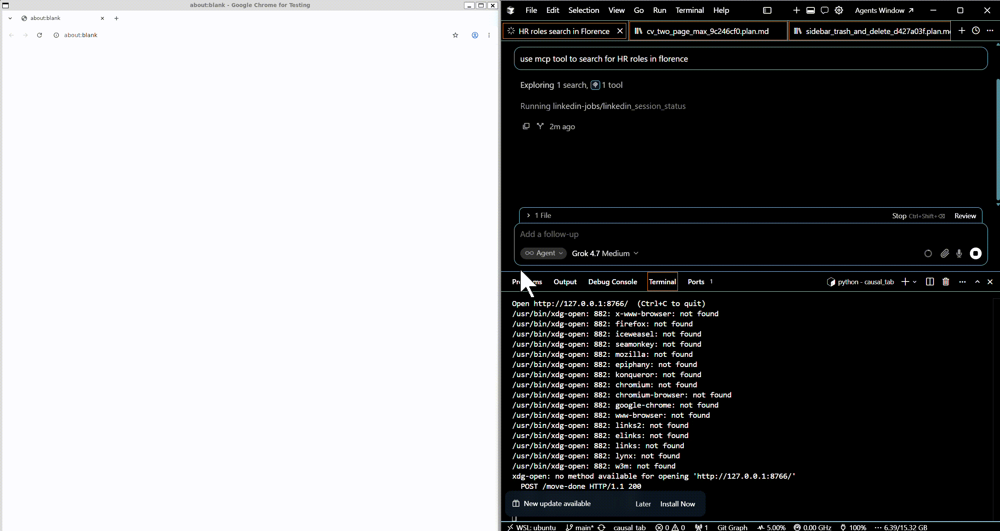

# MCP Server for exploring and extracting LinkedIn Job Postings

This is a small MCP server that sits between Cursor and LinkedIn Jobs. The point is to browse safely the job search portion of the site without risk of giving full access to the site to the model.

The project lives in `mcp_server`. Cursor starts `server.py` and talks JSON-RPC on stdin and stdout. Logs stay on stderr. The model never gets the password as a tool argument and never writes it itself. Email and password come from the process environment, filled from a local `.env` when they are missing.

## A browser with a short leash

The server opens a visible Chromium window through Playwright and keeps a persistent profile in `.browser_profile`. Signing in once leaves the `li_at` cookie there, so later runs can reuse the session. `linkedin_login` only fills the form when the window is actually on the login page. A checkpoint stays in that window until I finish it by hand.

The tools refuse to leave the jobs surface. Search results and an open posting are allowed. The feed, company pages, profiles, and the rest of the web are not. `open_job` will only open an id that was on the last results page the model just saw.

The browser never gets a free-form click or URL. Every move is a goto to a jobs URL the server builds, and after that move the page is checked against a regex. Opening a posting is a second check: the id has to be one of the ids that were actually returned in the last jobs_page_html call.

What the model reads is not the raw page. `jobs_page_html` returns a short HTML document built from the cards and, when one is open, the posting. Cards already present in the library are marked `data-known`. The description is cut off so a long post does not fill the context.



## Remembering a post

Two folders hold the output texts:

- `jobs_extracted` keeps every post worth remembering, interesting or not.
- `jobs_interesting` is the smaller set that matches what I asked for in that chat.

`jobs_minhash.jsonl` is the catalog for both. A duplicate check looks at the LinkedIn job id first. If the id is new, it estimates Jaccard similarity with MinHash: word 4-grams, 64 permutations, Blake2b as the hash. A score of 0.5 or higher is treated as the same post. `extract_job` writes the file and appends a signature only when the post is new.

The model chooses the query, which cards to open, which posts to extract, and which of those to move. It does not write the files itself.

## The MCP objects
###  Prompts:
* `find_jobs` takes an optional interest string.
  Basic instructions to search for “interesting” job roles. If interest is empty, the text tells the model to ask what you want before moving any post. The prompt does not browse or save anything. It only tells the model how to use the tools: pick the query, open cards, extract posts worth remembering, and move only the ones that match.

### Resources:
* `linkedin://session` is read-only JSON.
  It reports three flags: whether the profile directory exists, whether the browser is running, and whether a LinkedIn li_at cookie is present. It does not navigate. If the browser has not started, the last two flags are false.

### Tools:  
* `linkedin_login` has no arguments.
  It opens https://www.linkedin.com/login. If the profile is already signed in, it returns "signed in" and does not type anything. Otherwise it fills the email and password fields from the environment, clicks Sign in, and waits up to 20 seconds. A checkpoint or challenge stays in the visible window; you finish that by hand, then call the tool again. The password never appears in the tool result.

* `linkedin_session_status` returns the same three flags as the resource, read from the live browser.

* `open_job_search` takes query and an optional location.
  A plain query becomes https://www.linkedin.com/jobs/search-results/?keywords=.... If location is set, it is appended to the keywords. A full LinkedIn jobs-search URL is opened as given. Any other URL is rejected. After the page loads, the tool waits 2–6 seconds, checks the address is still a jobs page, and waits up to 20 seconds for result cards. It returns how many cards it found and the URL. It does not save posts.

* `jobs_page_html` is how the model reads the page.
  It walks the live DOM, including shadow roots, and collects up to 30 cards from job ids in links and card attributes. Each card becomes an <article data-job-id="..."> with title, company, location, and a short snippet. If that id is already in jobs_minhash.jsonl, the article is marked data-known="true". If a posting is open (a /jobs/view/ URL, a currentJobId= URL, or a description longer than 80 characters), it also returns a <section data-surface="job_post">. The description is cut at 50,000 characters, and the whole document at 80,000. The ids included in that HTML become the only ids open_job will accept.

* `next_results_page` stays on the current search.
  It scrolls the results list three times. If no new cards appear, it adds 25 to the start query parameter and loads that URL. It reports how many cards are visible and how many are new. You then call jobs_page_html to read them.

* `open_job` takes a numeric job_id.
  The id must be one that was on the last jobs_page_html result. The tool then goes to https://www.linkedin.com/jobs/view/{id}/. Call jobs_page_html again to read the posting.

* `back_to_results` loads the last search URL, or the jobs search home if there is none.
  Every navigation above runs a guard. The URL must match LinkedIn job search or a single job view (/jobs/search, /jobs/search-results, or /jobs/view/{id}). A company page, profile, feed, login wall, or any other site is not returned to the model. The window is sent back to the last jobs URL, and the tool raises an error. 

* `check_duplicate` reads the open posting and compares it with jobs_minhash.jsonl.
  It returns JSON: is_new, score, threshold (0.5), path, and reason. An exact LinkedIn job id is a match immediately (reason is job_id, score 1.0). Otherwise it estimates Jaccard similarity with MinHash: words of length at least 2, 4-word shingles, 64 permutations, Blake2b. A score of 0.5 or higher is a duplicate. Nothing is written.

* `extract_job` saves the open posting when that check says it is new.
  The file is {company}_{title}.txt under mcp_server/jobs_extracted, using the same slug rules as the CV tools. The first line is the canonical job URL, then a blank line, then the full description. A matching line is appended to jobs_minhash.jsonl. If the id or the MinHash score already matches, nothing is written and the existing path is returned.

* `show_extracted_job` takes a filename stem or a numeric job id.
  It looks in jobs_extracted first, then jobs_interesting, and returns the path, which folder it is in, and the file text.

## Usage with Cursor
Needs uv installed.
add the following to your .cursor/mcp.json

``` json
{
  "mcpServers": {
    "linkedin-jobs": {
      "type": "stdio",
      "command": "uv",
      "args": [
        "run",
        "--with-requirements",
        "${workspaceFolder}/mcp_server/requirements.txt",
        "python",
        "${workspaceFolder}/mcp_server/server.py"
      ],
      "envFile": "${workspaceFolder}/mcp_server/.env",
      "env": {
        "LINKEDIN_PROFILE_DIR": "${workspaceFolder}/mcp_server/.browser_profile"
      }
    }
  }
}

```

add .env inside the mcp_server folder with the following contents:
```
LINKEDIN_EMAIL=your@email.com
LINKEDIN_PASSWORD=yourpassword
```


GitHub repository: [https://github.com/piantedosi/linkedin_mcp](https://github.com/piantedosi/linkedin_mcp)