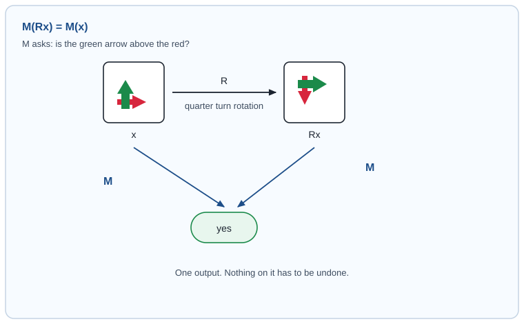
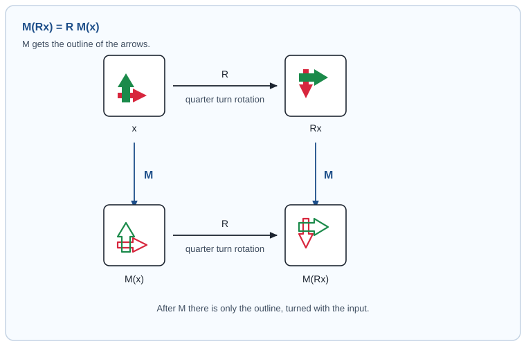
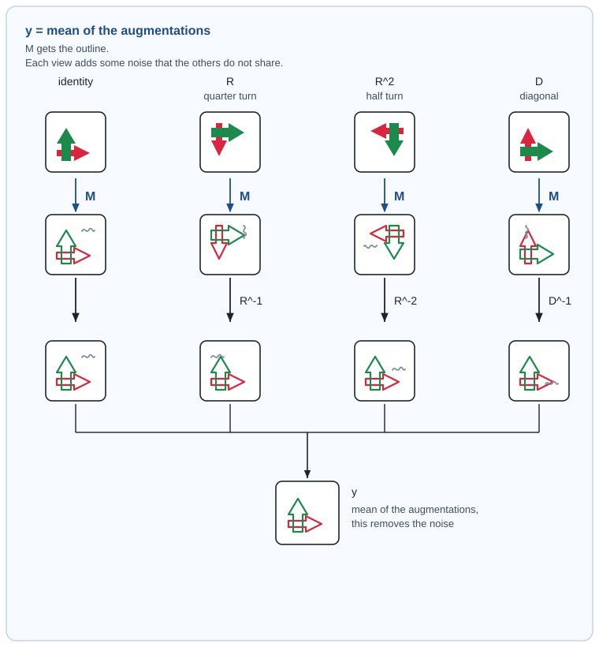
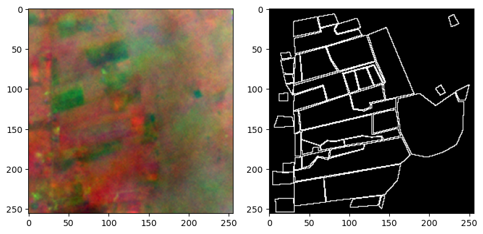
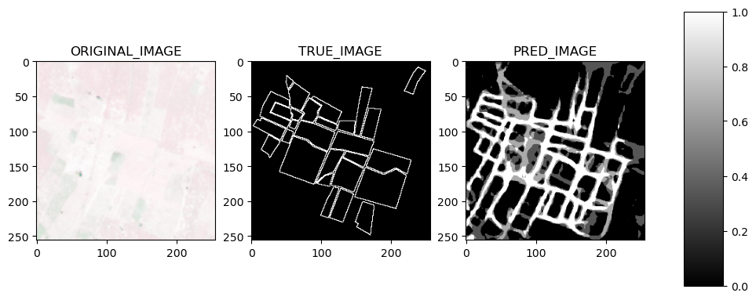
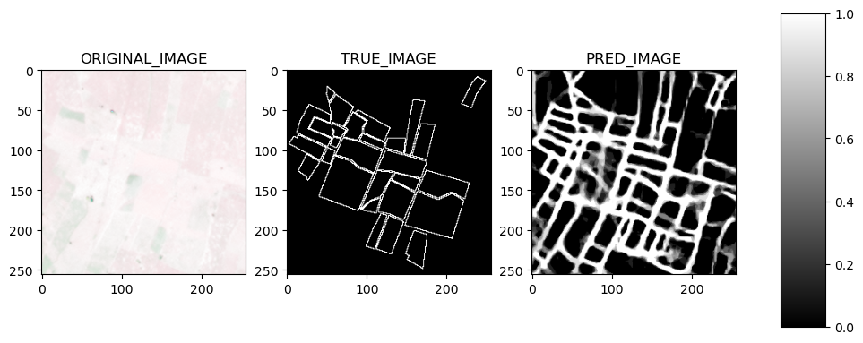

# Post Train Augmentation

## Introduction

In this blog post we will look at a way to get better results from a fixed model after it has already been trained. We will do this without changing the weights by employing a technique called "post-training augmentation". The basis of this technique are the concepts of invariance and equivariance. We will transform each example, run the frozen model, and pool the predictions reducing random errors.

## The general concept

Let $$G$$ be a group of transformations (for example, rotations or flips), and let $$g \cdot x$$ mean "$$g$$ applied to the input $$x$$". In the figures, $$R$$ is a quarter turn. The red arrow and the green arrow are only there so the turn is visible.

So let's define the concepts of invariance and equivariance in a more formal way.

### Invariant

$$M$$ is **invariant** under $$G$$ when the output does not move:

$$ M(g \cdot x) = M(x) \qquad \forall g \in G $$

Here $$M$$ asks a yes-or-no question: is the green arrow above the red? A quarter turn moves both arrows, and the green one stays above the red, so both applications of $$M$$ answer "yes". The label did not move, so there is nothing to undo. At inference the answers are averaged as they are:

$$ \hat{y} = \frac{1}{|G|} \sum_{g \in G} M(g \cdot x) $$

Many scalar task are invarian under specific symmetries and if such and invariance is known, it can be exploited to improve the output of a model. For example, almost all image classification task are invariant under vertical flips.

### Equivariant

$$M$$ is **equivariant** under $$G$$ when the output moves with the input, by the same transformation:

$$ M(g \cdot x) = g \cdot M(x) \qquad \forall g \in G $$

Here $$M$$ gets the outline of the arrows. A quarter turn of the input is matched by the same quarter turn of that outline. The output is not invariant. It changes, and because we chose the turn we know the inverse.

Like for the invariant case, many tasks are equivariant under specific symmetries. This is oftern the case when the input has the same shape as the output. For example, image segmentation and object detection tasks are equivariant under rotations and flips.

## Post-training augmentation

We can now define the post-training augmentation technique. Here $$M$$ is the same map as in the equivariant example: it gets the outline of the arrows. The procedure is to transform the input by $$g$$, run $$M$$, and map the outline back by $$g^{-1}$$.

$$ \hat{y}_g = g^{-1}\big(M(g \cdot x)\big) $$

In the following figure we can see 4 transformations of the input: the identity, a quarter turn, a half turn, and a diagonal reflection. Each different processing of the input adds some noise that the others augmentations do not share. So by averaging the augmentations we can reduce the noise improve the prediction.

$$ \hat{y} = \frac{1}{|G|} \sum_{g \in G} \hat{y}_g $$

## The field example

The task is field boundary segmentation on Planet imagery of smallholder farms in Rwanda, from the NASA Harvest field boundary challenge. We are tasked to predict the boundary of the fields from satellite imagery.

Under the symmetries of the square the mask is equivariant. There are eight of them: the identity, rotations by $$90^\circ$$, $$180^\circ$$ and $$270^\circ$$, a flip along each axis, a transpose, and one flip followed by a $$90^\circ$$ rotation. Each has an inverse in the same set, so each prediction can be turned back before the pool. 

Here we can see an example of a single prediction before and after the post-training augmentation. The prediction follows the true boundaries, but the lines are thick and a few of them bleed into the field interior.

Here is the same example after the eight transformed and inverted predictions are averaged. The boundaries tighten, and the false response inside the fields drops.

The model that produced these results was alwasys the same one, trained on the same data, and with the same architecture. The only difference was the post-training augmentation.

[back home](https://piantedosi.github.io/)
